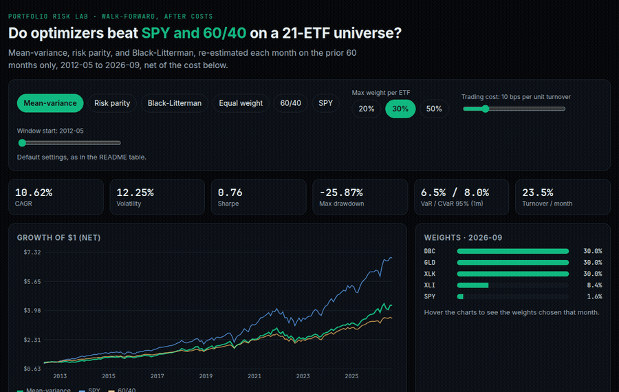
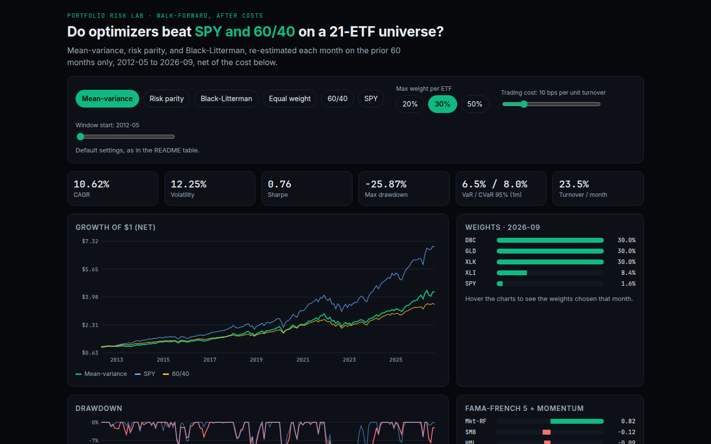
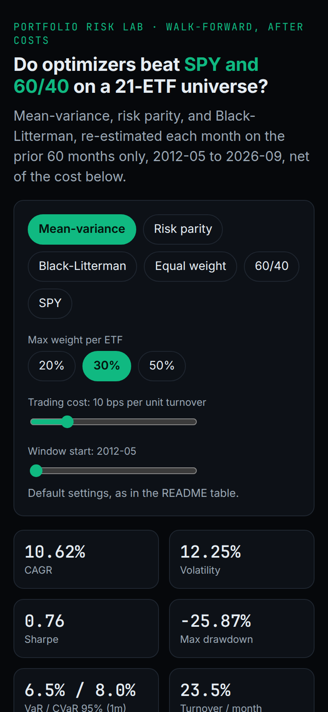

# portfolio-risk-lab

[](https://github.com/ParBproject/portfolio-risk-lab/actions/workflows/ci.yml)

Walk-forward mean-variance, risk parity, and Black-Litterman on 21 ETFs,
net of trading costs, compared with SPY, 60/40, and equal weight. Monthly historical VaR and CVaR,
drawdowns, and an OLS regression on the Fama-French five factors plus momentum.

App: [parbproject.github.io/portfolio-risk-lab](https://parbproject.github.io/portfolio-risk-lab/)



| Desktop | Mobile |
|---|---|
|  |  |

## Results

2012-05 to 2026-09, after 10 bps per unit of turnover.
Weights each month use only the prior 60 months.

SPY has the highest Sharpe, 0.92. None of the three optimizers beat the better of SPY and 60/40 on Sharpe.
Risk parity's max drawdown is -12.72%, against -23.93% for SPY,
with volatility 5.45% versus 14.03%. No alpha t-stat reaches 2.
Mean-variance alpha is -2.20% a year (t = -1.63).

| Strategy | CAGR | Vol | Sharpe | Max DD | VaR95 (1m) | CVaR95 (1m) | Avg turnover / month |
|---|---|---|---|---|---|---|---|
| Mean-variance | 10.62% | 12.25% | 0.76 | -25.87% | 6.48% | 7.97% | 23.49% |
| Risk parity (ERC) | 5.30% | 5.45% | 0.68 | -12.72% | 2.42% | 2.93% | 8.85% |
| Black-Litterman | 9.39% | 11.69% | 0.69 | -16.52% | 5.23% | 7.33% | 52.33% |
| Equal weight (1/N) | 8.26% | 9.57% | 0.71 | -18.61% | 4.09% | 5.65% | 2.34% |
| 60/40 SPY/IEF | 9.16% | 8.99% | 0.84 | -20.52% | 4.00% | 5.14% | 1.58% |
| SPY | 14.45% | 14.03% | 0.92 | -23.93% | 6.10% | 8.32% | 0.00% |

### Factor regression (2012-05 to 2026-08)

| Strategy | Alpha (ann.) | t(alpha) | Mkt-RF | SMB | HML | RMW | CMA | MOM | R² |
|---|---|---|---|---|---|---|---|---|---|
| Mean-variance | -2.20% | -1.63 | 0.82 | -0.12 | -0.09 | 0.17 | 0.08 | 0.13 | 0.85 |
| Risk parity (ERC) | -0.28% | -0.32 | 0.31 | 0.00 | -0.07 | 0.08 | 0.12 | 0.01 | 0.66 |
| Black-Litterman | -1.92% | -0.97 | 0.69 | -0.03 | -0.03 | 0.07 | 0.24 | 0.32 | 0.64 |
| Equal weight (1/N) | -1.11% | -1.17 | 0.62 | 0.01 | -0.00 | 0.08 | 0.12 | -0.01 | 0.88 |
| 60/40 SPY/IEF | -0.39% | -0.56 | 0.61 | -0.07 | -0.07 | 0.05 | 0.05 | 0.01 | 0.92 |
| SPY | -0.13% | -0.54 | 0.99 | -0.11 | 0.02 | 0.05 | 0.02 | 0.00 | 1.00 |

## Data

Prices: yfinance auto_adjust=True (dividend/split-adjusted close), from Yahoo Finance via `yfinance`, 21 ETFs,
requested 2007-01-01 to 2026-10-01 (end exclusive).
Factors: Kenneth R. French Data Library, FF5 2x3 + Momentum, monthly.

Month-end simple returns run from 2007-05 to 2026-09.
The factor files end in 2026-08. Tickers: DBC, EEM, EFA, GLD, HYG, IEF, IWM, LQD, SHY, SPY, TIP, TLT, VNQ, XLB, XLF, XLI, XLK, XLP, XLU, XLV, XLY.

`data/raw/` has 4 files. `data/MANIFEST.json` holds a SHA-256 for each one,
and `make all` fails if a file has changed. `make fetch` downloads a new copy and will change
the hashes and the results. The prices are stored so the study can be rerun offline;
Yahoo's terms still apply. The French factors are published for research use.

## Method

- Sample covariance, shrunk 50% toward its diagonal.
  Long only. Mean-variance and Black-Litterman cap each ETF at 30%.
  Risk parity is uncapped.
- Mean-variance: maximise w'mu - (lambda/2) w'Σw, lambda = 5.0.
  mu is the trailing sample mean.
- Risk parity: equal risk contribution.
- Black-Litterman: equal-weight prior (delta = 2.5, tau = 0.05).
  Absolute views (trailing 12m mean, skip 1m) on every ETF. The posterior mean goes into the same
  mean-variance optimizer.
- Historical 95% VaR and CVaR on monthly net returns.
  Drawdowns are taken from the net wealth path.
- The regression uses Mkt-RF, SMB, HML, RMW, CMA, and MOM. t-stats are classical OLS,
  not Newey-West.

## Caveats

- The Black-Litterman prior is equal weight. There is no market-cap portfolio for this ETF list.
- Black-Litterman turnover averages 52.33% a month,
  because the views follow recent returns. Costs are deducted.
- The ETFs were all still listed when the list was chosen in 2026, so funds that had already
  closed are not in the sample.

## Run

```bash
pip install -e ".[dev]"
make all      # check hashes, rerun the backtest, rewrite this file, ruff, pytest
make fetch    # re-download prices and factors (online; changes the hashes)
make web      # export the app data, run the Node tests, build the app (Node 20+)
make deploy   # publish web/dist to the gh-pages branch
```

`scripts/build_readme.py` fills the tables from `results/summary.json`.
At the default settings (cap 30%, 10 bps) the web app
matches those figures; `make web` checks that.
